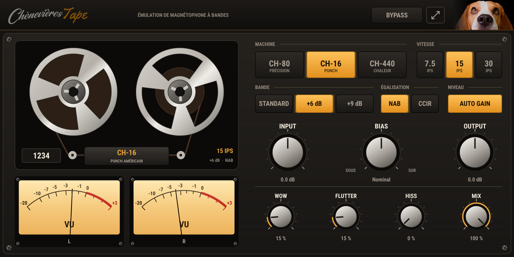

# Chènevières Tape

Émulation de magnétophone à bandes du Studio des Chènevières (VST3 / AU / AAX).

| Réglage | Rôle |
|---|---|
| Machine | CH-80 (précision suisse), CH-16 (punch américain), CH-440 (chaleur vintage) |
| Vitesse | 7,5 / 15 / 30 ips : head bump, bande passante, souffle, pleurage |
| Bande | Standard, +6 dB, +9 dB : marge avant saturation, souffle |
| Égalisation | NAB ou CCIR (constantes de temps de préaccentuation) |
| Input / Output | niveau envoyé sur la bande / niveau de sortie (Auto gain : la sortie compense l'entrée) |
| Bias | sous-polarisation (plus brillant, plus de distorsion) ↔ sur-polarisation (plus sombre, plus propre) |
| Wow / Flutter | pleurage et scintillement (communs aux deux canaux, comme sur une vraie bande) |
| Hiss | souffle de bande |
| Mix | mélange parallèle avec le signal direct (aligné) |

0 VU = sinus à -18 dBFS.

Le moteur (`Source/TapeEngine.*`) est en C++ pur, sans JUCE : il servira aussi au futur magnétophone 16 pistes.
Voir `NOTES-DEV.md`.
